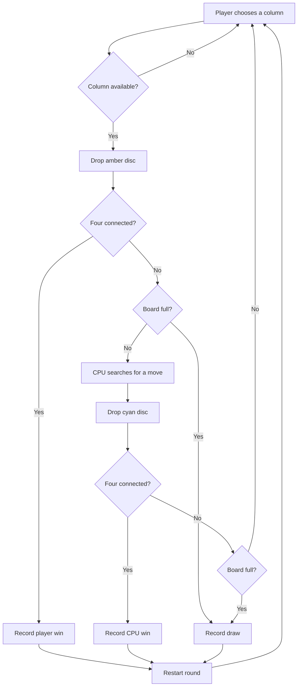

# Fourplay

A polished, keyboard-friendly Connect Four game built with Vue 3 and TypeScript. Play as amber against a cyan CPU that looks ahead, takes winning moves, and blocks obvious fours. Your local record is saved in your browser.

**Play:** [oscarmmi.github.io/connect-four](https://oscarmmi.github.io/connect-four/)

## How to play

- Drop an amber disc into a column by clicking or tapping it, or press **1–7**.
- Connect four discs horizontally, vertically, or diagonally before the CPU does.
- Press **R** or select **Restart** to begin a new round.
- Your wins, losses, and draws are stored locally on this device.

## Run locally

```sh
npm install
npm run dev
```

Run the pure game-logic tests and production build:

```sh
npm test
npm run build
```

## Game loop



## Built with

Vue 3 · TypeScript · Vite · Vitest
